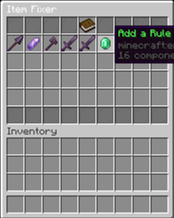
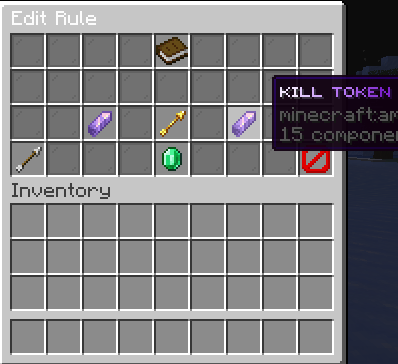

# ItemFixer

[](https://papermc.io/)
[](https://papermc.io/)
[](https://adoptium.net/)

Replaces old kit items with the new ones an admin pairs in a menu. Built for FFA and kit servers where swords, armor, and custom items change and the old copies stop working.

One jar. No extra plugins.

<p>
  
  
</p>

---

# 🔄 Item Replacement

* **Pair old and new** – Each rule is one old item and the item it becomes.
* **Keeps the stack** – A stack of 12 stays a stack of 12. Only the item changes.
* **Exact match** – Name, enchants, and item data count. Amount does not.
* **One pass** – A stack is replaced once per check, so chained rules do not cascade in the same tick.
* **Chat notice** – Players with `itemfixer.notify` get one line when something of theirs changed.

---

# 📖 Rule Menu

`/itemfixer` opens a chest. The top and bottom rows are glass. The middle is the rule list.

* **One icon per rule** – The icon is the old item. Its name is the old item, then `-->`, then the new item, with each item’s own colors kept.
* **Book** – Top middle. Explains the menu.
* **Add** – A glowing emerald sits right after the last rule. If the page is full, it is the first slot on the next page.
* **Pages** – Previous and next arrows show up only when another page exists.

Click a rule to edit it. Click the emerald to add one.

---

# ✏️ Editor

A 4-row menu.

* **Left slot** – The old item.
* **Right slot** – What it becomes.
* **Spectral arrow** – Sits between the two slots.
* **Click or shift-click** – Takes an item back out of a slot.
* **Save** – The emerald glows once both slots are filled.
* **Back** – Bottom left, returns to the list.
* **Delete** – Bottom right, only while editing an existing rule.

Delete opens a small confirm menu. Green confirms, red cancels. The rule icon stays in the middle so it is obvious which one is going.

Closing the editor or the confirm menu gives back anything you placed. Preview copies of saved rules are not given out as real items.

---

# 🎒 What Gets Scanned

Checked on the player:

* Inventory
* Armor
* Offhand
* Cursor
* Ender chest, only when `scan.ender-chest` is true (off by default)

Not checked:

* Chests, barrels, and other world containers
* Items nested inside shulkers or bundles

If the new item stacks smaller than the old one, the slot keeps a full stack and the rest drops at the player’s feet.

Armor slots are skipped when `optimisations.skip-armor-without-equipable` is on and none of the old items are wearable armor.

---

# 🌍 Worlds And Bypass

* **Bypass** – Anyone with a permission listed under `bypass-permissions` is left alone. Default node is `itemfixer.bypass` (default false).
* **Blacklist** – Skip the worlds in the list. An empty list repairs every world.
* **Whitelist** – Repair only the worlds in the list.
* World names ignore case.

Offline players cannot be checked for bypass. A bypass player who is offline during `/itemfixer fixall` is still repaired.

---

# ⏱️ How Often It Runs

Repairs stay on the main thread, a few players at a time, so a kit swap does not spike the server.

* **`cycle-seconds`** – How often online players are checked again. Default 20.
* **`players-per-tick`** – How many players are repaired on one tick. Default 1.
* Join, pickup, and closing a chest also mark that player to be checked.
* Players standing in a skipped world, or with bypass, are not checked.
* `/itemfixer reload` applies `config.yml`, `rules.yml`, and `messages.yml` without a restart. A broken config keeps the previous settings.

---

# 👥 Fix Everyone

`/itemfixer fixall` repairs people who are online and people who are offline.

* Online players go through the same per-tick budget as the normal check.
* Offline players are read from the primary world’s `playerdata` folder.
* A file is rewritten only when something changed, and never while that player is online.
* Stacks that do not fit in an offline inventory are stored and dropped at their feet on the next join, with one notice.

---

# 💬 Messages

All text lives in `plugins/ItemFixer/messages.yml`. MiniMessage tags work on every line.

```yaml
gui:
  save: "<green>Save Rule"
  delete: "<red>Delete Rule"
```

Gray is the body, white is the emphasis, green is a success, and red is a stop. The plugin does not lowercase the file or paint over your tags. `/itemfixer reload` reads it again.

---

## Commands

| Command | Permission | Description |
|---------|------------|-------------|
| `/itemfixer` | `itemfixer.admin` | Opens the rule list. Players only. |
| `/itemfixer reload` | `itemfixer.admin` | Reloads config, rules, and messages. |
| `/itemfixer fixall` | `itemfixer.admin` | Repairs online players, then offline player files. |

Console can run `reload` and `fixall`. Opening the menu requires a player.

---

## Permissions

| Permission | Default | Description |
|------------|---------|-------------|
| `itemfixer.admin` | OP | Open the menu, reload, and run fixall |
| `itemfixer.notify` | true | Hear when your items are updated |
| `itemfixer.bypass` | false | Keep old items. Also the default entry in `bypass-permissions` |

---

## Configuration

Main config: `plugins/ItemFixer/config.yml`

| Key | Default | What it does |
|-----|---------|----------------|
| `bypass-permissions` | `itemfixer.bypass` | Permissions that skip the repair |
| `worlds.mode` | `blacklist` | `blacklist` skips the list, `whitelist` repairs only the list |
| `worlds.list` | empty | World names, case ignored |
| `scan.ender-chest` | `false` | Also check ender chests |
| `optimisations.skip-armor-without-equipable` | `true` | Skip armor slots when no old item is wearable armor |
| `cycle-seconds` | `20` | Seconds between full online checks |
| `players-per-tick` | `1` | Players repaired on each tick |

Rules are stored in `plugins/ItemFixer/rules.yml`. Overflow from offline repairs is stored in `plugins/ItemFixer/pending.yml`.

---

## Requirements

- **Minecraft:** Paper 1.21 through 26.3
- **Java:** 21 or newer
- **Build:** Maven, `mvn package`, output `target/itemfixer.jar`

Folia is not supported.

---

## Installation

1. Build with `mvn package`, or download a release jar
2. Place `itemfixer.jar` in your server’s `plugins` folder
3. Restart the server
4. Edit `plugins/ItemFixer/config.yml` and `plugins/ItemFixer/messages.yml` if you want
5. In game, run `/itemfixer` and pair each old item with the new one
6. Reload later with `/itemfixer reload`
